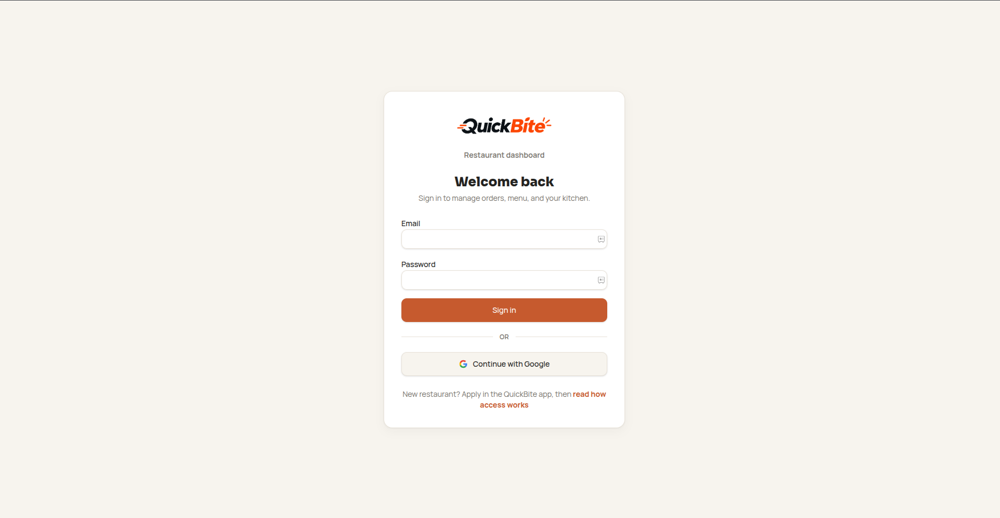
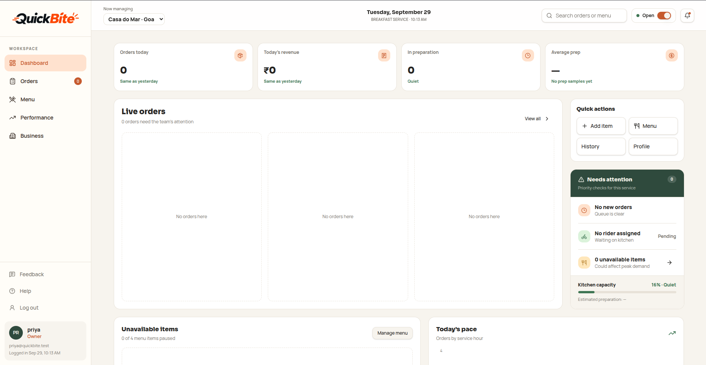
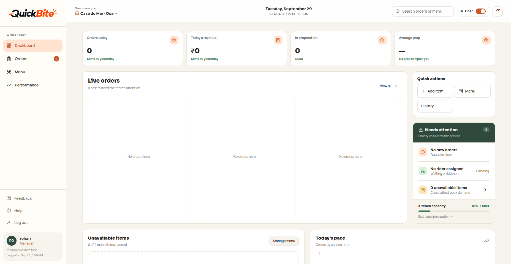

# QuickBite

Food ordering and delivery for **customers**, **riders**, and **restaurants** — a Swiggy/Zomato-style product in one monorepo: Expo mobile app, role-based web dashboard, marketing landing, and a shared Supabase backend.

Built as an SJ Innovation intern assignment with **Lovable + Supabase + GitHub + Vercel**, then extended with Expo, edge functions, and an AI ordering assistant (**RIO**).

---

## Problem

Local food delivery needs three people to hand work to each other safely: a customer places an order, a kitchen prepares it, a rider delivers it. Most toy demos fake that handoff or share one flat UI. Real ops also need distance-honest fees, role isolation, and a support path when something goes wrong.

## Solution

QuickBite is one Postgres database with **RLS + RPCs** as the authority. Each role sees only its sidebar and rows. Order status moves through a fixed machine (`placed → preparing → ready → out_for_delivery → delivered`). Money, delivery range (8 km), and kitchen capacity are enforced in SQL and the apps — not only in copy.

## What is not common

- **Role handoff chain** across mobile + dashboard, not a single “demo user”
- **Security-definer RPCs** for order writes (no client `UPDATE orders`)
- **RIO** — JWT-scoped customer AI that can search, cart, checkout, track, and open tickets
- **Truth layer** — kitchen offers, km fees, near-me default, audited admin force/refund
- **Owner → manager invite** pipeline plus admin applications for riders/owners

---

## Live

| Surface | Link |
|---------|------|
| Restaurant / admin dashboard | [quickbite-nine-phi.vercel.app](https://quickbite-nine-phi.vercel.app/) |
| Marketing landing | `apps/landing` (deploy as its own Vercel project) |
| GitHub | [sanketrotangar-sji/quickbite-food-delivery-app](https://github.com/sanketrotangar-sji/quickbite-food-delivery-app) |
| Lovable (manager UI) | Connect to this monorepo under `apps/manager` only |

**Docs:** [REQUIREMENTS](./docs/REQUIREMENTS.md) (product SoT) · [PROGRESS](./docs/PROGRESS.md) (status) · [PLAN](./docs/PLAN.md) (pre-submission backlog)

---

## Screenshots

<p align="center">
  
  <br />
  <em>Shared web login — admins, owners, and managers land on role-specific screens</em>
</p>

<p align="center">
  
  <br />
  <em>Owner dashboard — restaurants, branches, and operations overview</em>
</p>

<p align="center">
  
  <br />
  <em>Manager kitchen — live orders, menu, and branch controls</em>
</p>

---

## Roles overview

| Role | App | How they get it | Primary nav |
|------|-----|-----------------|-------------|
| **Customer** | `apps/client` | Default on signup | Home, Explore, Orders, RIO, Profile |
| **Rider** | `apps/client` | Apply → admin approves | Home, Orders, Earnings, Profile |
| **Restaurant manager** | `apps/manager` | Owner email invite | Dashboard, Orders, Menu, Performance |
| **Restaurant owner** | `apps/manager` | Apply → admin approves | Same as manager + **Business** |
| **Admin** | `apps/manager` `/admin` | SQL seed only | Dashboard, Tickets, Orders, Riders, Applications, Restaurants, Users, Offers, AI |

One account = one `profiles.role` (no multi-role). Need both customer and rider? Use two accounts.

Full tables, RLS, and workflow: [`docs/REQUIREMENTS.md`](./docs/REQUIREMENTS.md).

---

## Tech stack

| Layer | Technology |
|-------|------------|
| Mobile | Expo Router (React Native) — `apps/client` |
| Marketing | Vite + React — `apps/landing` |
| Web dashboard | Vite + React (Lovable-friendly) — `apps/manager` |
| Backend | Supabase (Auth, Postgres, RLS, Realtime, Edge Functions) |
| AI / RAG | Groq or Ollama chat (`llm_config`) · Ollama `qwen3-embedding:0.6b` (1024-d) · pgvector |
| Source | GitHub monorepo |
| Deploy | Vercel (landing + dashboard) · EAS (Android APK/AAB) · Supabase (API & DB) |

```text
┌─────────────────┐
│  apps/landing   │  public marketing entry
└────────┬────────┘
         │ Dashboard Login
         ▼
┌──────────────────────────────┐  ┌─────────────────────┐
│  apps/manager                │  │  apps/client        │
│  admin · owner · manager     │  │  customer · rider   │
└──────────────┬───────────────┘  └──────────┬──────────┘
               │                             │
               └──────────────┬──────────────┘
                              ▼
                   Supabase Auth · Postgres · RLS
```

---

## Repository structure

```text
QuickBite/
├── apps/
│   ├── landing/          # Marketing site
│   ├── manager/          # Admin + restaurant dashboard
│   └── client/           # Customer + rider Expo app
├── supabase/
│   ├── migrations/       # Schema, RLS, RPCs (source of truth)
│   ├── functions/        # notify-new-order, send-order-sms, create-payment-intent, stripe-webhook, directions, rio
│   └── seed.sql          # Local demo seed
├── packages/shared/
├── assets/               # README screenshots
├── docs/
│   ├── REQUIREMENTS.md   # Product / schema SoT
│   └── PROGRESS.md       # Done / next / decisions
├── scripts/
├── .env.example
└── README.md
```

---

## Prerequisites

- Node.js ≥ 20
- Docker (optional local Supabase)
- Supabase CLI
- Expo Go or EAS build (mobile); Android package `com.sjinnovation.quickbite`

---

## Quick start

### 1. Backend

```bash
supabase start          # local Docker
supabase status         # copy API URL + anon key
```

Or cloud (day-to-day SoT for this project):

```bash
supabase link --project-ref <YOUR_PROJECT_REF>
supabase db push
```

New migrations = **schema / RPC / RLS / indexes only** — no demo `INSERT` data (use `supabase/seed.sql` for local demos).

### 2. Environment

```bash
cp .env.example apps/manager/.env
cp apps/client/.env.example apps/client/.env
# landing (optional): apps/landing/.env.example
```

| App | Variables |
|-----|-----------|
| Manager | `VITE_SUPABASE_URL`, `VITE_SUPABASE_ANON_KEY` |
| Client | `EXPO_PUBLIC_SUPABASE_URL`, `EXPO_PUBLIC_SUPABASE_ANON_KEY` |
| Landing | `VITE_DASHBOARD_URL`, optional store URLs |

**Server-only** (Supabase Edge secrets / root `.env` for scripts — never `EXPO_PUBLIC_*` / `VITE_*`):

| Secret | Purpose |
|--------|---------|
| `SUPABASE_SERVICE_ROLE_KEY` | Scripts / admin tooling |
| `WEBHOOK_SECRET` | `notify-new-order` + `send-order-sms` webhooks |
| `TWILIO_ACCOUNT_SID` / `TWILIO_AUTH_TOKEN` / `TWILIO_FROM_NUMBER` | Outbound order-status SMS |
| `STRIPE_SECRET_KEY` / `STRIPE_WEBHOOK_SECRET` | Stripe test Checkout + signed webhook |
| `STRIPE_CHECKOUT_SUCCESS_URL` / `STRIPE_CHECKOUT_CANCEL_URL` | Optional Checkout redirects |
| `OPENROUTESERVICE_API_KEY` | `directions` (OSRM fallback if missing) |
| `GROQ_API_KEY` | RIO chat (when Groq active) |
| `OLLAMA_BASE_URL` | RIO chat + embeddings host |
| `EXPO_ACCESS_TOKEN` | Optional Expo push |

```bash
supabase secrets set WEBHOOK_SECRET=$(openssl rand -hex 32)
supabase secrets set GROQ_API_KEY=<key>
supabase secrets set OLLAMA_BASE_URL=<reachable-host>
# After you have Twilio / Stripe test keys:
# supabase secrets set TWILIO_ACCOUNT_SID=... TWILIO_AUTH_TOKEN=... TWILIO_FROM_NUMBER=...
# supabase secrets set STRIPE_SECRET_KEY=sk_test_... STRIPE_WEBHOOK_SECRET=whsec_...
supabase functions deploy notify-new-order
supabase functions deploy send-order-sms
supabase functions deploy create-payment-intent
supabase functions deploy stripe-webhook
supabase functions deploy directions
supabase functions deploy rio
```

**A3-T1 ops (once):** apply migration `20261011160000_t1_payments_and_sms.sql`; Database Webhook on `orders` INSERT/UPDATE → `send-order-sms` with header `x-webhook-secret`; Stripe Dashboard webhook → `…/functions/v1/stripe-webhook` for `payment_intent.succeeded`, `checkout.session.completed`, `charge.refunded`.

### 3. Frontends

```bash
npm install
npm run landing      # http://localhost:5174
npm run dashboard    # http://localhost:5173
npm run client       # Expo
```

### 4. Auth (email + Google)

Enable **Email** and **Google** providers in Supabase → Authentication. Add redirect URLs for the Vercel origin and `quickbite://` (Expo). Signup always creates `profiles.role = customer` via trigger.

### 5. Lovable (manager only)

1. Lovable project → connect **this** GitHub monorepo → keep output under `apps/manager`
2. Connect the **same** Supabase project
3. **Never** let Lovable edit `/supabase` — migrations stay in GitHub
4. Browser env: only `VITE_SUPABASE_URL` + `VITE_SUPABASE_ANON_KEY`
5. `apps/client` is Expo — **not** Lovable

### 6. Deploy

| Surface | How |
|---------|-----|
| Dashboard | Vercel project → root / `apps/manager` (existing: quickbite-nine-phi) |
| Landing | Separate Vercel project, root `apps/landing` |
| Edge functions | `npm run functions:deploy` or `supabase functions deploy …` |
| Android APK | `cd apps/client && npx eas-cli build -p android --profile preview` |
| Android store | EAS profile `production` → AAB |

EAS builds do **not** read local `.env`. Set `EXPO_PUBLIC_SUPABASE_*` (and `GOOGLE_SERVICES_JSON` file env for FCM) in EAS for `preview` / `production`.

---

## Useful scripts

| Script | Purpose |
|--------|---------|
| `npm run db:push` | Push migrations to linked cloud DB |
| `npm run functions:deploy` | Deploy edge functions |
| `npm run types:gen` | Regenerate client + manager DB types |
| `npm run embeddings:backfill` | Embed menu/ratings/order history (`--source all`) |
| `npm run intelligence:verify` | Smoke RAG / tickets / auto-assign |
| `npm test` | Unit + edge + integration (+ Playwright when enabled) |
| `npm run check:secrets` | Fail if service role leaked into client env patterns |
| `npm run ml:cancel-risk` | Cancel-risk sklearn eval (F1≥0.80); writes `docs/ml/cancel-risk-*` |
| GitHub Actions `ci.yml` | Push/PR: secrets + unit + edge; integration/e2e when repo secrets set |

---

## Project status

See [`docs/PROGRESS.md`](./docs/PROGRESS.md). Product rules and schema: [`docs/REQUIREMENTS.md`](./docs/REQUIREMENTS.md). Agent rules: [`.cursor/rules/project.mdc`](./.cursor/rules/project.mdc).
