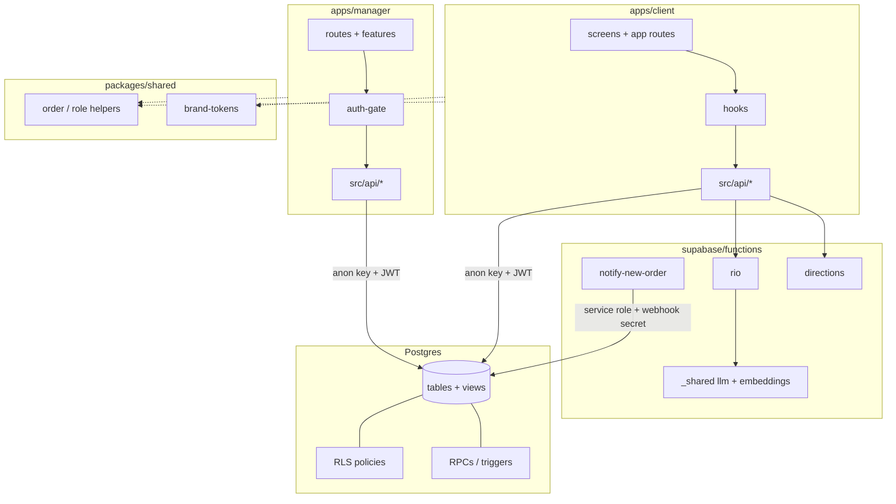
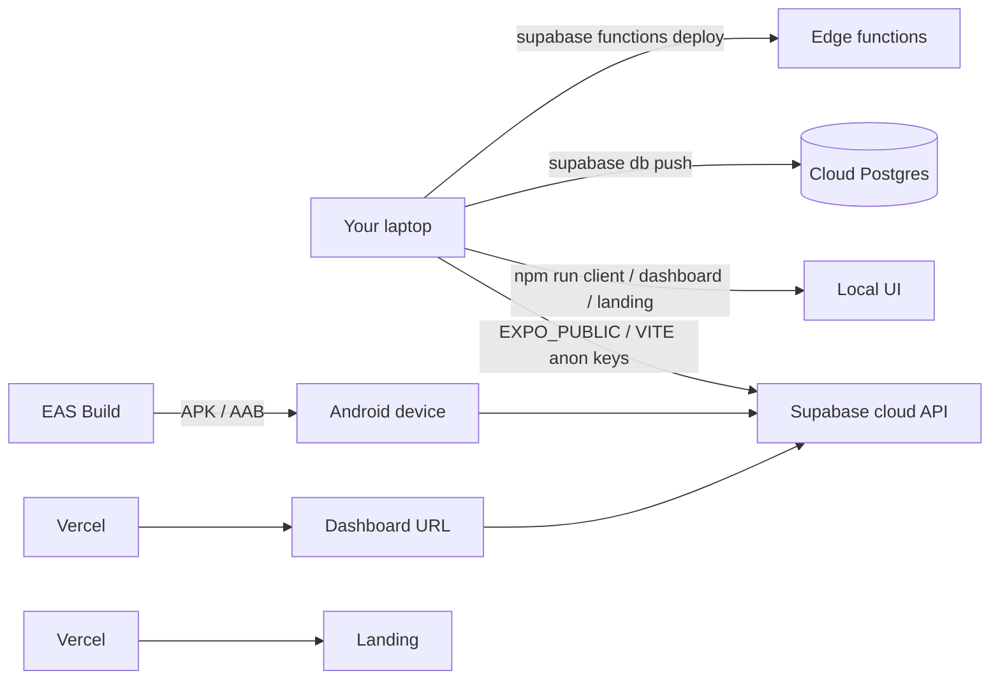

# 01 — Architecture

**Audience:** You (learner) + future-you after a break.  
**Evidence:** Repo layout, migrations, apps, `docs/00-audit.md`, your Phase 1 answers.

---

## What QuickBite is

QuickBite is a **food ordering and delivery platform** with five human roles:

| Role (product language) | DB value (`profiles.role`) | App |
|-------------------------|----------------------------|-----|
| Customer | `customer` | Mobile (`apps/client`) |
| Delivery rider | `rider` | Same mobile app, rider routes |
| Restaurant manager | `restaurant_manager` | Web dashboard (`apps/manager`) |
| Restaurant owner | `restaurant_owner` | Web dashboard |
| Admin | `admin` | Web dashboard `/admin` |

Everyone starts as a **customer** when they sign up. Higher roles are granted after applications or invites (see flows).

**Product + code (CONFIRMED BY YOU):** **single-role** design — one `profiles.role` per account (`20260922154000_single_role_column.sql`). A rider account does not also act as a customer on the same login (and likewise for other roles). Separate accounts if someone needs both.

---

## Tech stack (and why)

| Layer | Choice | Why (inferred from code + common practice) |
|-------|--------|---------------------------------------------|
| Mobile | Expo + Expo Router + React Native | One codebase for Android (and iOS later); file-based routes; FCM push worked with package `com.sjinnovation.quickbite` (**CONFIRMED BY YOU**). |
| Restaurant / admin web | Vite + React + TanStack Router | Fast dashboard UX; role gate in browser. |
| Marketing | Vite landing (`apps/landing`) | Public front door without loading the full dashboard. |
| Backend | Supabase (Postgres, Auth, RLS, Realtime, Edge Functions, Storage) | Auth + DB + policies in one place; RLS keeps role rules next to the data. |
| Shared rules | `packages/shared` + `supabase/functions/_shared/rules.ts` | Same order/role helpers in app and edge. |
| AI (RIO) | Edge function + Groq or Ollama chat + Ollama embeddings + pgvector | Chat can switch provider; embeddings stay one model (768-d) so the vector index stays valid. |
| Maps | MapLibre + `directions` edge function (OpenRouteService) | Server holds the maps API key; client never sees it. |
| Deploy | Vercel (web), EAS (Android APK/AAB), Supabase cloud | **CONFIRMED:** EAS + package id final because FCM worked. |

**Source of truth for data:** your **linked cloud Supabase project** (ref appears in scripts/comments as `motqehtswgjbbvoazarh`).  
**Local Docker** (`supabase start`) is supported by the repo (`supabase/config.toml`) but you primarily work against cloud (**CONFIRMED BY YOU** — you thought only cloud existed). Local is optional for offline experiments.

---

## System context

```mermaid
flowchart LR
  subgraph people [People]
    C[Customer]
    R[Rider]
    M[Manager / Owner]
    A[Admin]
  end

  subgraph apps [Apps]
    Client[Expo client]
    Dash[Manager dashboard]
    Land[Landing site]
  end

  subgraph supabase [Supabase cloud]
    Auth[Auth]
    DB[(Postgres + RLS)]
    RT[Realtime]
    EF[Edge functions]
    ST[Storage menu-images]
  end

  subgraph external [External]
    Groq[Groq API]
    Ollama[Ollama host]
    ORS[OpenRouteService]
    ExpoPush[Expo Push / FCM]
  end

  C --> Client
  R --> Client
  M --> Dash
  A --> Dash
  Land -->|CTA to app / login| Client
  Land -->|Dashboard login| Dash

  Client --> Auth
  Client --> DB
  Client --> RT
  Client --> EF
  Dash --> Auth
  Dash --> DB
  Dash --> RT

  EF --> Groq
  EF --> Ollama
  EF --> ORS
  EF --> ExpoPush
  EF --> DB
  Client --> ST
  Dash --> ST
```

---

## Component diagram

**Why API folders:** Keep Supabase calls in one place (`apps/client/src/api/`, `apps/manager/src/api/`) so screens do not each invent queries.

---

## Deployment / environments

| Environment piece | What it is |
|-------------------|------------|
| **Anon URL + key** | Public; safe in the app. RLS still applies. |
| **Service role key** | Secret; bypasses RLS. Scripts, edge, optional server — **never** `EXPO_PUBLIC_*`. |
| **Edge secrets** | `GROQ_API_KEY`, `OLLAMA_BASE_URL`, `WEBHOOK_SECRET`, `OPENROUTESERVICE_API_KEY`, etc. |

Manager file `apps/manager/src/integrations/supabase/client.server.ts` can create a service-role client, but **no route in `apps/manager/src` imports it today** (only E2E helpers use the key). Treat production dashboard as **anon + user JWT** unless you wire server routes later.

---

## Major subsystems

### Auth
Supabase Auth (email/password + Google). Trigger `handle_new_user` creates `profiles` as `customer`. Role escalation via admin-reviewed applications or owner invites → `private.grant_role`.

### Ordering
Cart → `place_order` RPC → kitchen status RPCs → rider claim / deliver RPCs. History via trigger. No direct client UPDATE on `orders`.

### Realtime
Kitchen and tracking subscribe to Postgres changes (orders, menu, restaurants, rider locations).

### Intelligence
RIO edge assistant; `embeddings` + `match_embeddings`; support tickets; auto rider assign on `ready`; kitchen-load cron. **Your view:** RAG must be proper; current dataset/embeddings are not trusted as correct (**CONFIRMED BY YOU**).

### Notifications
`push_device_tokens` + `notify-new-order` webhook (JWT verification off; secret-gated).

---

## What “production-ready” means here

Before adding features, harden:

1. Security (RLS gaps, RAG PII, webhook).  
2. Data quality (seed vs real, constraints).  
3. Keep **single-role** rules clear in UX (blocked screens when the wrong app side is opened).  
4. Observability and release path (EAS APK you already use).  
5. Order acceptance timeout (**CONFIRMED BY YOU** — build it).

Details and proposals land in Phase 3 (`11-fix-plan.md`), not in this file.
