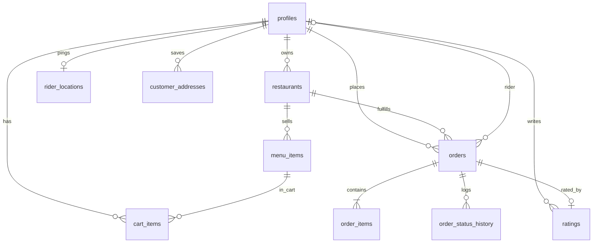

# 03 — Database

**Source of truth:** `supabase/migrations/` (apply order = filename timestamp).  
**New migrations rule:** schema / RPC / RLS / indexes only — **no demo `INSERT` data** (use `supabase/seed.sql` for local demos; see [`12-environments.md`](./12-environments.md)).  
**Live row counts:** not measured in Phase 1/2 without an approved read-only query against cloud.

**Terms:** A **table** stores rows. A **column** is a field. A **PK** uniquely identifies a row. An **FK** points at another table’s PK. An **enum** is a fixed list of allowed words. A **trigger** is SQL that runs automatically on insert/update. An **RPC** is a Postgres function the app can call.

---

## ER overview (core ordering)



Extended entities (applications, members, invites, notifications, tickets, embeddings, automation_*) attach to `profiles` / `orders` / `restaurants` as documented below.

---

## Naming vs required spec

| Rule | Reality |
|------|---------|
| Plural snake_case tables | Mostly yes |
| snake_case columns | Yes |
| Every table has `id` PK | Exceptions: `rider_locations` (`rider_id`), `user_roles` / `restaurant_members` (composite), `automation_config` (`key`) |
| Every table has `created_at` | Exceptions: `orders` (`placed_at`), `order_items`, `order_status_history` (`changed_at`), `rider_locations`, `llm_config` |
| FKs end `_id` | Yes |
| Status words lowercase | Yes — `order_status` enum |

---

## Enums

| Enum | Values | File |
|------|--------|------|
| `app_role` | `customer`, `restaurant_manager`, `rider`, `restaurant_owner`, `admin` | init + extend migrations |
| `order_status` | `placed`, `preparing`, `ready`, `out_for_delivery`, `delivered`, `cancelled` | init |
| `application_kind` | `rider`, `restaurant_owner` | roles |
| `application_status` | `pending`, `approved`, `rejected` | roles |
| `member_status` | `active`, `revoked` | roles |
| `invite_status` | `pending`, `accepted`, `revoked` | roles |
| `ticket_status` | `open`, `in_progress`, `resolved` | intelligence |
| `ticket_urgency` | `low`, `medium`, `high` | intelligence |

---

## Table-by-table (plain language)

### `profiles`
**Why:** One app identity per Auth user. Same UUID as `auth.users.id` so `auth.uid()` compares cleanly.

| Column | Meaning |
|--------|---------|
| `id` | PK = auth user id |
| `full_name`, `email`, `phone` | Contact |
| `role` | Single primary role today |
| `is_online`, `vehicle_label`, `plate` | Rider duty / vehicle UI |
| `created_at`, `updated_at` | Timestamps |

### `restaurants`
**Why:** A kitchen / branch that owns a menu and receives orders.

Notable columns: `owner_id`, `name`, `cuisine`, `address`, `phone`, `image_url`, `is_open`, `branch_name`, `lat`/`lng`, `offer_percent`, `prep_minutes`, timestamps.

### `menu_items`
**Why:** Dishes for sale. Price is source of truth at order time (snapshotted into `order_items`).

Notable: `restaurant_id`, `name`, `price`, `is_available`, `category`, `is_veg`, images, timestamps.

### `orders`
**Why:** One customer checkout against one restaurant. Status drives the whole delivery machine.

Notable: `customer_id`, `restaurant_id`, `rider_id`, `status`, `total_amount`, `delivery_fee`, address + lat/lng (and optional `delivery_address_id`), rider pay fields, `placed_at` (**not** `created_at`), `delivered_at`, `updated_at`.

### `order_items`
**Why:** Line items frozen at purchase (name/price snapshot so later menu edits do not rewrite history). **No `created_at`.**

### `cart_items`
**Why:** Working basket before checkout. Unique `(customer_id, menu_item_id)`. Trigger forces one restaurant.

### `order_status_history`
**Why:** Audit trail of status changes. Written only by trigger `log_order_status`. PK is bigint identity; time column is `changed_at`.

### `ratings`
**Why:** One review per delivered order (`unique(order_id)`). Food 1–5; optional delivery score + comment.

### `rider_locations`
**Why:** Live “where is the rider now?” — one row per rider (`rider_id` PK), overwritten each ping. Not a GPS history log.

### `customer_addresses`
**Why:** Saved home/work/other addresses with optional coordinates; orders still snapshot text onto the order.

### `user_roles`
**Why historically:** Multi-role list. **Today:** mirror of `profiles.role` after single-role migration. Composite PK `(user_id, role)`.

### `applications` / `restaurant_members` / `manager_invites`
**Why:** Partner onboarding and hiring managers without giving everyone write access via RLS (writes go through RPCs).

### `home_highlights`
**Why:** Home screen offers/videos rail. Some seed rows were inserted **inside a migration** (data-in-migration smell).

### `notifications`
**Why:** In-app notification inbox rows.

### `push_device_tokens`
**Why:** Expo push endpoints per device.

### `llm_config`
**Why:** Which chat provider (groq/ollama) is active for RIO. No API keys in the table — keys stay in edge secrets.

### `embeddings`
**Why:** Vector index for RAG. Columns: `source_table`, `source_id` (text), `content_hash`, `embedding` vector(768), `created_at`. No client policies — service/backfill + `match_embeddings` RPC.

### `support_tickets`
**Why:** Customer complaints from RIO / support path.

### `automation_events` / `automation_config`
**Why:** Log auto-assign / kitchen-load actions; store thresholds as JSON by `key`.

---

## Views

| View | Why |
|------|-----|
| `restaurant_browse` | Customers see kitchens without `owner_id` / `phone` |
| `restaurant_rating_public` | Only `restaurant_id` + `food_rating` for averages |

---

## Important triggers

| Trigger | Effect |
|---------|--------|
| `on_auth_user_created` | Create customer profile |
| `profiles_guard_update` | Block client role/email edits |
| `cart_items_rules` | One restaurant; derive `restaurant_id` |
| `orders_log_status_*` | Append history |
| `restaurants_guard_owner_id` | Stop managers stealing ownership |
| `orders_auto_assign_rider` | On → `ready`, pick nearest online rider |
| Address / push / llm touch triggers | Defaults and timestamps |

---

## Important RPCs (public)

| RPC | Purpose |
|-----|---------|
| `place_order` | Cart → order + items; clear cart |
| `restaurant_set_order_status` | Kitchen transitions |
| `claim_delivery` | Rider claims unclaimed order |
| `rider_set_order_status` | Out for delivery / delivered |
| `list_rider_delivery_pool` | Redacted available jobs |
| `rider_set_duty` / `rider_update_location` | Online + GPS |
| `submit_application` / `admin_review_application` | Partner pipeline |
| `owner_create_branch` / `owner_invite_manager` / `accept_manager_invite` / `owner_revoke_manager` | Owner ops |
| `activate_llm_config` | Admin switches chat provider |
| `match_embeddings` | Vector search for RAG (**PII risk** — see security doc) |
| `run_kitchen_load_alerts` | Cron: bump ETA when kitchen overloaded |
| `register_push_device` | Save Expo token |
| `set_default_customer_address` | One default address |
| `standard_delivery_fee` | Canonical ₹ fee |

---

## Indexes (why they exist)

- Filter hot paths: orders by customer / restaurant+status / rider; unclaimed partial index.  
- Menu by restaurant (+ available).  
- Cuisine browse.  
- HNSW on embeddings for cosine search.  
- Unique constraints that encode business rules (one rating per order, one active LLM, one active manager membership per user).

---

## Order status machine (data side)

```text
placed → preparing → ready → out_for_delivery → delivered
                ↘ cancelled (from placed/preparing)
```

Rider may be assigned at `preparing` or `ready` (claim or auto-assign). Full role rules: [`05-flows.md`](./05-flows.md).
