# 05 — Flows

Sequence diagrams for the main journeys. Boxes named after real files/RPCs where useful.

---

## Order status state machine

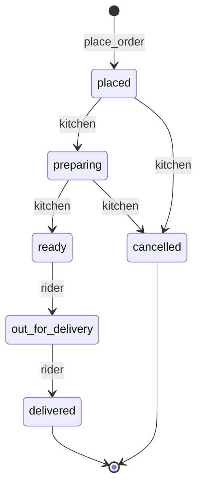

| Transition | Who | Mechanism |
|------------|-----|-----------|
| → `placed` | Customer | RPC `place_order` |
| `placed` → `preparing` | Manager/owner of that kitchen | `restaurant_set_order_status` |
| `preparing` → `ready` | Kitchen | same |
| `placed`/`preparing` → `cancelled` | Kitchen | same |
| Assign `rider_id` while `preparing`/`ready` | Rider claim **or** auto-assign trigger on `ready` | `claim_delivery` / `auto_assign_rider` |
| `ready` → `out_for_delivery` | Assigned rider | `rider_set_order_status` |
| `out_for_delivery` → `delivered` | Assigned rider | same |

**Product TODO (CONFIRMED BY YOU):** **order acceptance timeout** — if kitchen leaves an order in `placed` too long, auto-cancel (or similar). Not implemented yet; design in Phase 3.

Self-deal guards: you cannot kitchen-handle or rate in ways that game your own restaurant / own delivery (RPC + rating RLS).

---

## Sign-up (email)

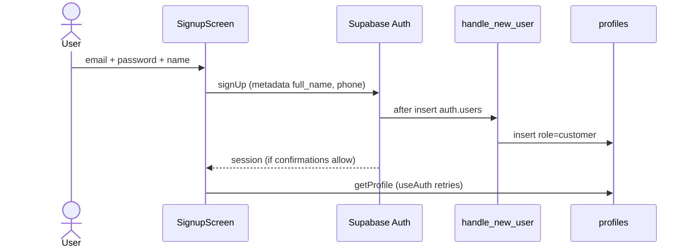

**Google:** same trigger; metadata uses Google `name`. Client: `signInWithGoogle` in `apps/client/src/api/auth.ts`. Manager: parallel in `apps/manager/src/api/auth.ts`.

---

## Login → home

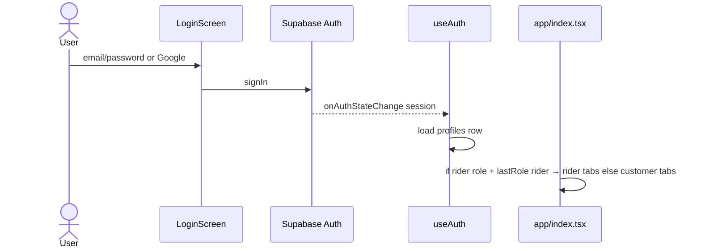

Dashboard: `auth-gate.tsx` sends admin / owner / manager to their routes; others blocked.

---

## Browse restaurants

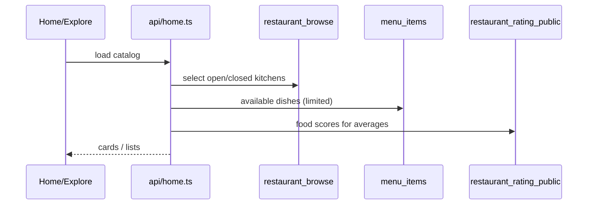

---

## Cart → place order

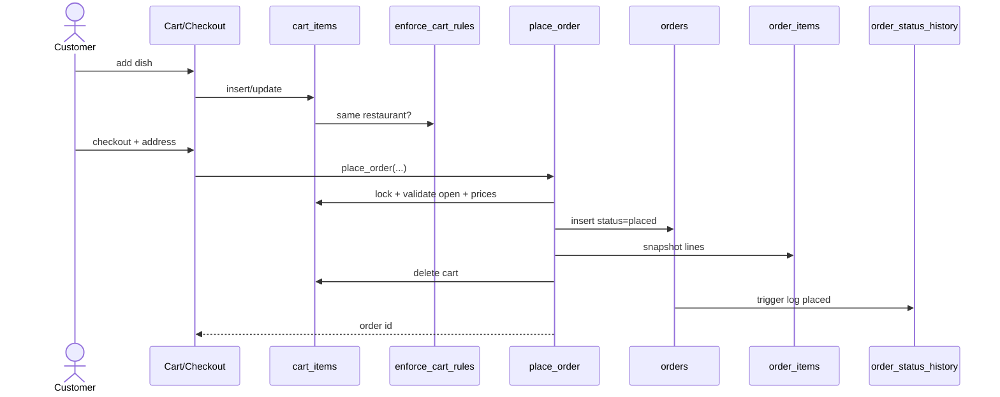

---

## Kitchen accepts → ready

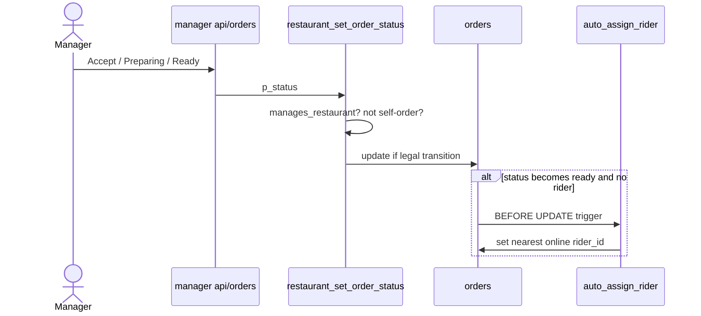

Optional: DB webhook → `notify-new-order` → Expo push.

---

## Rider claim → deliver

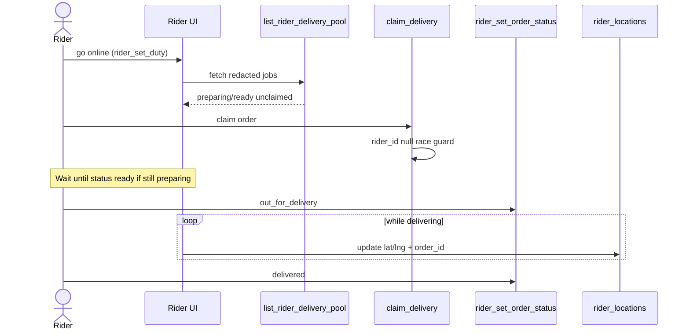

---

## Customer tracking

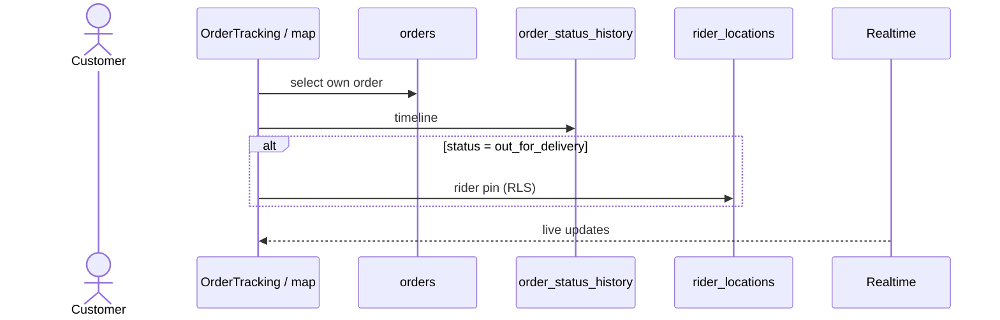

---

## Rating

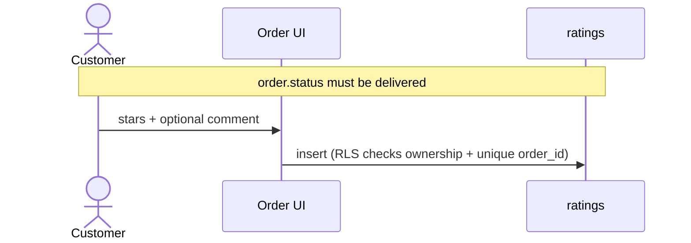

---

## RIO (high level)

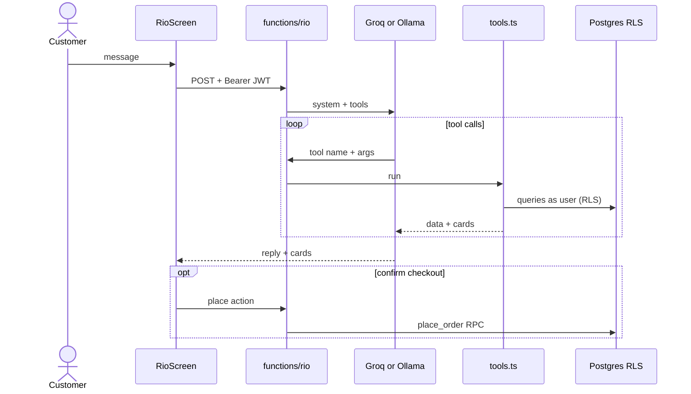

Tool details: [`06-rio-assistant.md`](./06-rio-assistant.md).

---

## Partner application (rider / owner)

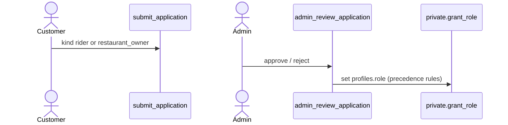

Manager hire: owner → `owner_invite_manager` → invitee `accept_manager_invite`.
