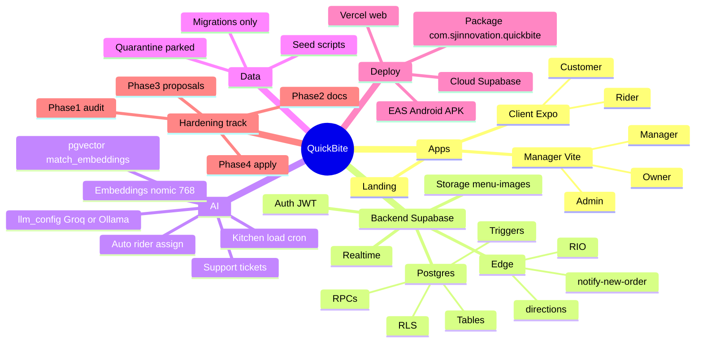

# 07 — Mind map & mental model

## Mermaid mindmap

---

## One-page mental model (memorize this)

**Three surfaces, one brain.**  
Mobile (customer + rider), web dashboard (owner/manager/admin), landing. All talk to **one** Supabase project.

**Auth makes the person; `profiles.role` opens the doors.**  
Signup always creates a **customer**. Higher roles are granted later. Today: **one role per account**. You want **multi-role later** (rider who also orders).

**Customers never UPDATE `orders` directly.**  
Cart → `place_order` → kitchen RPC → rider claim/status RPCs. History is a trigger. That is the spine of the product.

**RLS is the security model.**  
Anon key is public; policies + RPCs decide what each JWT may see. Service role bypasses everything — keep it off devices.

**RIO is a customer-scoped edge agent.**  
JWT in, tools run as that user, cards out. Chat provider is switchable; embeddings are not. RAG must not leak other people’s addresses (bug today).

**Cloud is home.**  
You develop against cloud Supabase. Local Docker is optional. Android id `com.sjinnovation.quickbite` via EAS (FCM already proved it).

**Migrations are history; don’t rewrite them.**  
Fix with new migration files. Seeds and quarantine are separate from schema.

**Next hardening:** security (RAG + webhook), seed cleanliness, multi-role design, order timeout, then polish.

---

## Picture of an order (say it out loud)

1. Customer adds food → `cart_items`.  
2. Place → `orders` + `order_items` + history `placed`.  
3. Kitchen → `preparing` → `ready` (maybe auto rider).  
4. Rider → `out_for_delivery` (map pin) → `delivered`.  
5. Customer may rate once.
