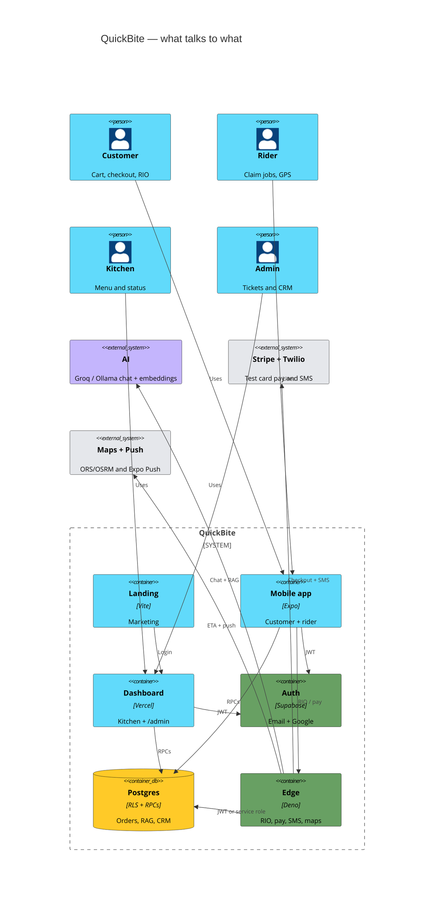
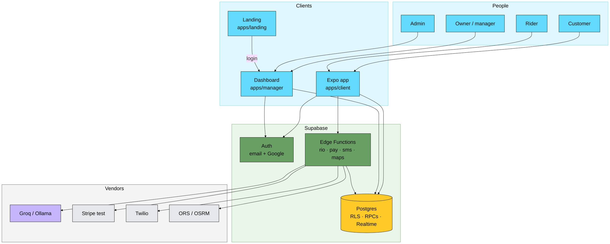
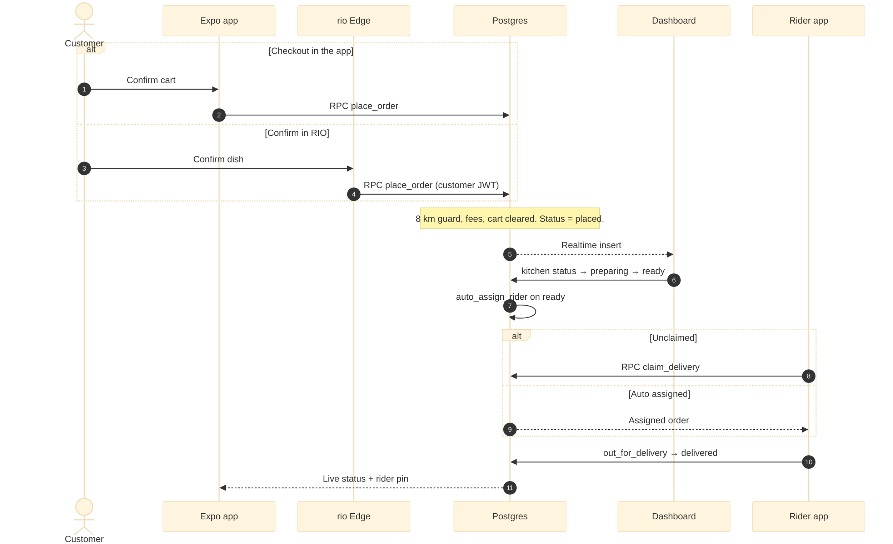
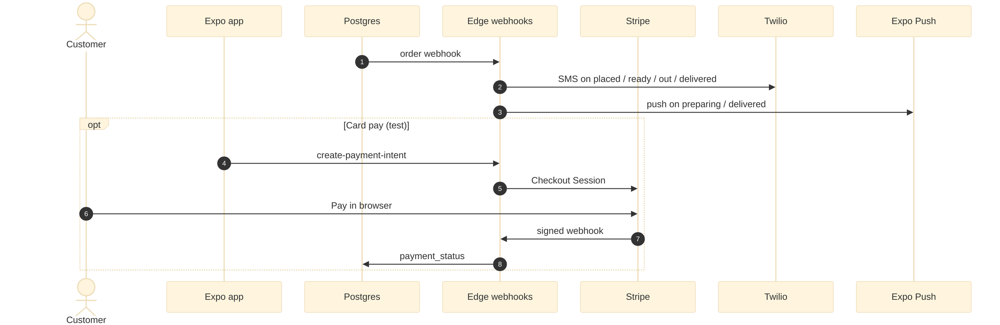
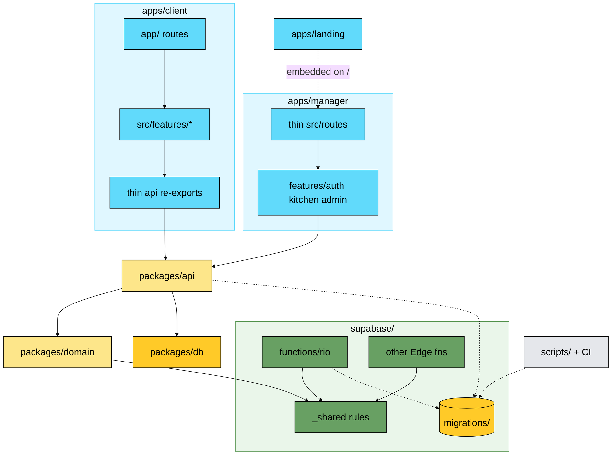

# QuickBite — architecture

How the monorepo fits together. Product rules stay in [`REQUIREMENTS.md`](./REQUIREMENTS.md). How we write code, where files go, and how vendors plug in: [`STANDARDS.md`](./STANDARDS.md). One account has one `profiles.role`. Order status changes only through security-definer RPCs.

**Preview:** open this file, then `Ctrl+K` then `V`. Diagrams keep their real size (scroll, do not shrink). Use the **+ / −** buttons on each diagram, or scroll the mouse wheel over it to zoom.

Blue is a client, green is Auth or Edge, amber is Postgres, purple is an AI vendor, gray is any other vendor.

---

## 1. High-level system architecture

Customers and riders share the Expo app. Owners, managers, and admins share the Vercel dashboard. Both send the anon key plus the user JWT, so Postgres RLS still applies when Edge runs RIO, Stripe, SMS, or push.

Solid arrows are calls. The service-role key stays on Edge and scripts, never in `EXPO_PUBLIC_*` or `VITE_*`. Hover a diagram and click **+** if you still need a closer look.

**Hardening note (2026-11-04):** payment state dual-writes to `order_payments`; SMS/push also enqueue `notification_jobs`; rider duty / RIO prefs dual-write `rider_profiles` / `customer_preferences`. Customer browse uses `restaurant_browse` (no synthetic kitchens). Checkout discounts resolve only via kitchen `%` + CRM (`private.resolve_checkout_offer`).

---

## 2. Data flow / request lifecycle

Cash is the default. Card pay is optional and happens after the order row exists. RIO uses the customer JWT, so it can call `place_order` and it cannot claim a rider or mark a refund.

---

## 3. Folder structure / module dependencies

Solid arrows are imports. Dashed arrows are a URL or a runtime call into Postgres. Apps call `bindSupabase(client)` then use `@quickbite/api`. Marketing lives only in `apps/landing`.
