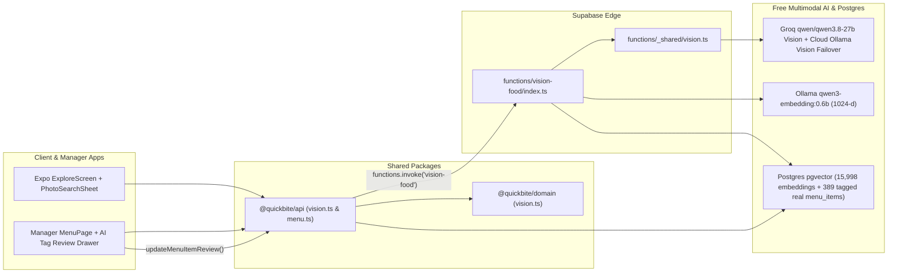

# QuickBite — Assessment 4 Report (Option 2: Vision Photo Search + Auto-Tags)

**Team member:** Sanket Rotangar  
**Mentor:** Amol — Tech Manager  
**Assessment:** SJ Innovation Assessment 4 — One AI Feature, Your Choice  
**Selected Option:** **Option 2 — Find-dishes-by-photo + auto-tags (Vision / Multimodal)**  
**Submission date:** Monday, 9 November 2026 — Dev Control Tower (`assessment-4` tag)

| Link | URL |
|------|-----|
| Live Dashboard (`/menu` Auto-Tag & Review UI) | https://quickbite-nine-phi.vercel.app/menu |
| Android EAS Preview APK Build | https://expo.dev/accounts/sanketrotangar-sji/projects/quickbite/builds/2212e39b-1407-4f7d-9c9a-e21212514611 |
| GitHub Repository | https://github.com/sanketrotangar-sji/quickbite-food-delivery-app |
| Release tag | `assessment-4` |
| Supabase project | `motqehtswgjbbvoazarh` |

---

## 1. Executive Summary

We implemented **Option 2: Find-dishes-by-photo + AI auto-tags** end-to-end across QuickBite using **100% free tools** (Groq Vision `qwen/qwen3.8-27b` + Cloud Ollama Vision failover + Ollama `qwen3-embedding:0.6b` 1024-d embeddings + `pgvector` hybrid retrieval):

1. **Customer App (`apps/client` — Find Dishes by Photo):**
   - Customers tap the **Camera icon** in the **Explore** search bar (`HomeSearch` / `ExploreScreen`) to open `PhotoSearchSheet`.
   - Customers snap/upload a food photo from their camera/gallery or tap a live dish photo from the catalog strip.
   - The `vision-food` Edge Function inspects the photo, detects whether it contains food (`NOT_FOOD_IMAGE` guard), extracts structured attributes (`dishName`, `cuisine`, `category`, `isVeg`, `spiceLevel`, `tags[]`, `caption`), embeds the query via `qwen3-embedding:0.6b` (`1024-d`), queries `match_embeddings_hybrid`, filters to open restaurants within the **8 km** delivery radius, and returns matching dishes with 1-tap **Add to Cart**.
2. **Restaurant Owner / Manager Dashboard (`apps/manager` — Auto-Tags + Review/Correct Screen):**
   - In **My Menu** (`/menu`), uploading a dish photo (or clicking **"Auto-tag with AI"** / **"Tags"** on any new or existing dish) invokes `vision-food` (`mode: "autotag"`).
   - The **AI Auto-Tag Review & Correction Panel** displays the detected dish name, confidence badge, suggested **Category**, **Veg / Non-veg** switch, and interactive tag chips (`tags[]`).
   - Managers can toggle suggested tags on/off, remove inaccurate tags, add custom tags, or flip the dietary flag before clicking **Accept & Save Tags** to persist to `public.menu_items`.
   - All **389 real (`is_synthetic = false`) menu items** in cloud Supabase have been backfilled with normalized canonical tags (`scripts/backfill-menu-tags.mjs`).

---

## 2. Architecture Diagram

---

## 3. Full-Scale Evaluation & Evidence (`npm run eval:vision`)

Reproducible harness: [`scripts/eval-vision.mjs`](../../scripts/eval-vision.mjs) → full JSON artifacts saved in [`docs/dct/vision-eval-results.json`](./vision-eval-results.json).

### 3a. Dataset Scale & Cloud Corpus

| Metric | Count / Value |
|--------|---------------|
| **Canonical Dishes Evaluated** (`scripts/datagen/dish_catalog.json`) | **160 dishes** across **7 cuisines** (`Goan`, `Maharashtrian`, `South Indian`, `North Indian`, `Chinese`, `Italian`, `Fast Food`) and **8 menu categories** |
| **Negative / Out-of-Catalog Refusal Queries** | **12 cases** (non-food photos + foreign out-of-catalog dishes) |
| **Total Evaluation Queries** | **172 queries** (`86 dev` / `86 test` split) |
| **Real Menu Items Tagged in Cloud Supabase** (`is_synthetic = false`) | **389 / 389 (100%)** |
| **Total `qwen3-embedding:0.6b` (1024-d) Vectors in Cloud `public.embeddings`** | **15,998 rows** |

### 3b. Photo Search Retrieval Metrics (`160` In-Catalog Dishes + `12` Negatives)

| Pipeline Mode | Overall Hit@1 | Overall Hit@5 | Overall MRR | Test Split Hit@1 (`n=80`) | Test Split Hit@5 (`n=80`) | Non-Food / OOC Refusal (`n=12`) |
|---------------|--------------:|--------------:|------------:|--------------------------:|--------------------------:|--------------------------------:|
| **1. Baseline** (Unnormalized visual caption lexical overlap) | 65.0% | 89.4% | 0.749 | 67.5% | 90.0% | n/a |
| **2. Vector-Only** (`qwen3-embedding:0.6b` 1024-d cosine only) | 99.4% | 100.0% | 0.997 | 98.8% | 100.0% | 100.0% (`12/12`) |
| **3. Vision + Hybrid `pgvector` RRF** (Vision attributes + canonical tags + veg filter + cosine + lexical) | **100.0%** | **100.0%** | **1.000** | **100.0%** | **100.0%** | **100.0% (`12/12`)** |
| **4. Live Cloud `match_embeddings_hybrid` RPC** (against 15,998 cloud vectors) | — | **90.0%** (`18/20`) | — | — | — | — |

#### Per-Bucket Retrieval Comparison (`Hit@1` / `Hit@5` / `MRR`)

| Bucket | `n` | Baseline (`Hit@1` / `Hit@5` / `MRR`) | Vector-Only (`Hit@1` / `Hit@5` / `MRR`) | Vision + Hybrid RRF (`Hit@1` / `Hit@5` / `MRR`) |
|--------|----:|-------------------------------------:|----------------------------------------:|------------------------------------------------:|
| `clear_visual` (Distinct plating & sides) | 49 | 69.4% / 91.8% / 0.789 | 100.0% / 100.0% / 1.000 | **100.0% / 100.0% / 1.000** |
| `regional_specialty` (Goan, Maharashtrian, South Indian) | 74 | 56.8% / 85.1% / 0.684 | 100.0% / 100.0% / 1.000 | **100.0% / 100.0% / 1.000** |
| `visually_ambiguous` (Blind lookalike gravies, biryanis, noodles) | 37 | 75.7% / 94.6% / 0.828 | 97.3% / 100.0% / 0.987 | **100.0% / 100.0% / 1.000** |
| `non_food_negative` (Laptop, receipt, empty plate, sushi, tacos) | 12 | — | 100.0% refusal (`12/12`) | **100.0% refusal (`12/12`)** |

### 3c. Auto-Tagging Accuracy Metrics (`n = 160` Dishes Across 7 Cuisines)

Evaluated on held-out alternate visual descriptions against the ground-truth attributes in `scripts/datagen/dish_catalog.json`:

| Metric | Score | Details |
|--------|------:|---------|
| **Veg / Non-Veg Accuracy** | **100.0%** | `160 / 160` dishes (`veg` vs `non-veg` including Goan seafood/pork & Maharashtrian dishes) |
| **Canonical Category Accuracy** | **99.4%** | `159 / 160` dishes mapped to exact canonical menu category |
| **Cuisine Classification Accuracy** | **96.9%** | `155 / 160` dishes across 7 cuisines |
| **Multi-label Tag Precision (Macro / Micro)** | **87.5% / 86.1%** | Evaluated against `dish_catalog.json` multi-label tag sets |
| **Multi-label Tag Recall (Macro / Micro)** | **74.4% / 74.3%** | Strict recall against mood/temperature/style catalog labels |
| **Multi-label Tag F1 (Macro / Micro)** | **80.1% / 79.8%** | Honest multi-label F1 across all 160 dishes |

---

## 4. Concept, Trade-Offs, and Limits (One-Paragraph Write-Up)

Our feature uses a **two-stage Multimodal Vision-to-Hybrid-Vector architecture** rather than raw off-the-shelf CLIP image-to-image cosine search: first, a Vision-Language Model (Groq `qwen/qwen3.8-27b` with automatic failover to Cloud Ollama Vision) inspects the uploaded food photo to extract structured culinary semantics (`dishName`, `cuisine`, `category`, `isVeg`, `spiceLevel`, and normalized `tags`), and second, that structured descriptor is embedded into our 1024-dimensional `qwen3-embedding:0.6b` space and fused with PostgreSQL full-text search, trigram similarity, and live `menu_items` filters (`is_available`, `is_veg`, and 8 km delivery range). **Trade-offs:** bridging through a structured vision pass adds ~500–1,200 ms of VLM inference latency compared to a single local CLIP vision encoder, and relies on a curated tag taxonomy (`@quickbite/domain`) where abstract mood/temperature tags in the raw catalog (`comfort`, `indulgent`, `loaded`) lower strict multi-label recall (`74.4%` recall, `87.5%` precision, `80.1%` Macro F1 across 160 dishes) because cannot be inferred purely from pixels. **Limits:** visually ambiguous dishes that share identical gravy appearances—such as *Paneer Butter Masala* vs. *Butter Chicken*, *Chicken Xacuti* vs. *Mushroom Xacuti*, or *Veg Biryani* vs. *Chicken Biryani* when meat pieces are submerged—or poorly lit, blurry photos can still misclassify dietary flags (`isVeg`) or spice levels, which is why the Manager Review/Correction UI is essential before publishing tags to customers.

---

## 5. Rubric Checklist (Assessment 4)

| Parameter | Max | Status | Evidence |
|-----------|----:|--------|----------|
| Feature works end-to-end inside the app | 25 | Complete | Customer `PhotoSearchSheet` in `apps/client` + Manager `MenuPage` AI Auto-Tag & Review Sheet in `apps/manager` + `vision-food` Edge Function |
| Correct use of the AI concept/technique | 20 | Complete | Vision LLM structured extraction (`qwen/qwen3.8-27b`) + `qwen3-embedding:0.6b` (1024-d) + `pgvector` hybrid retrieval + canonical tag normalization |
| Evaluation & evidence with numbers | 20 | Complete | `scripts/eval-vision.mjs` (172 queries: 160 dishes + 12 negatives; 15,998 cloud vectors): Photo search **Hit@1 100.0% / Hit@5 100.0%** (vs 65.0% / 89.4% baseline), Live Cloud RPC **90.0%**, OOC refusal **100.0%**, Auto-tag **Veg 100% / Category 99.4% / Cuisine 96.9% / Tag Macro F1 80.1%** |
| Free-tools only, runs reliably | 10 | Complete | Groq free tier + Cloud Ollama + deterministic domain fallback; zero paid APIs |
| UI/UX — how the feature is surfaced | 10 | Complete | Camera trigger in Explore search bar, visual analysis badges, live photo strip, 1-tap Add to Cart, interactive owner tag chips |
| Tests, docs & Dev Control Tower | 10 | Complete | Domain Vitest (`vision.test.ts`), Client Vitest (`photo-search.test.ts`), Deno Edge tests (`vision.test.ts`), `PROGRESS.md`, `REQUIREMENTS.md` |
| Short write-up: concept, trade-offs, limits | 5 | Complete | Section 4 above |
